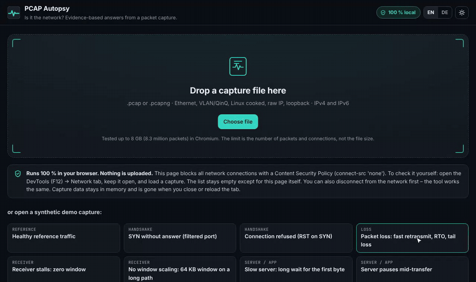
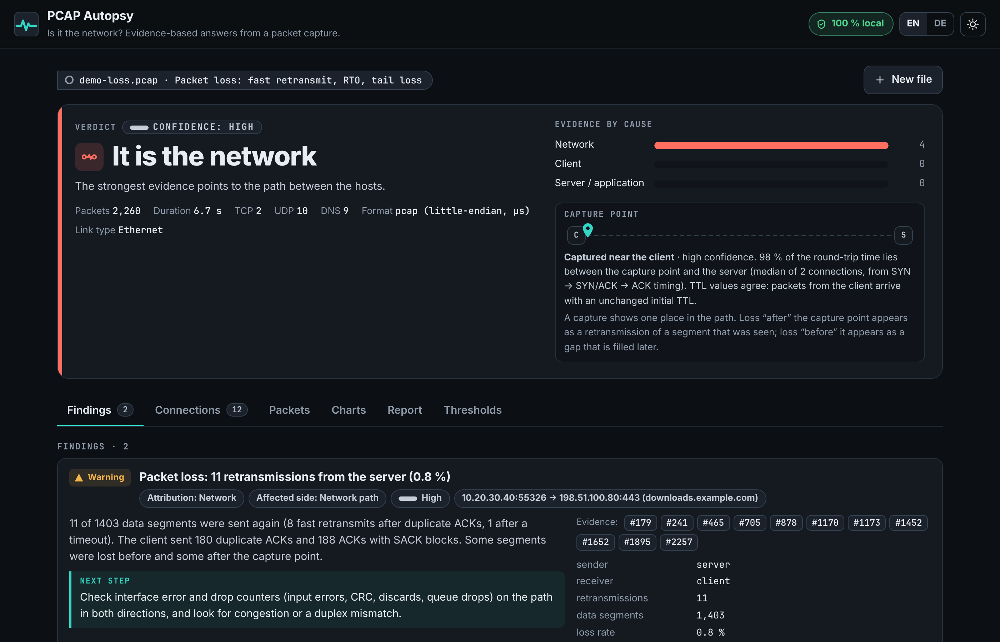
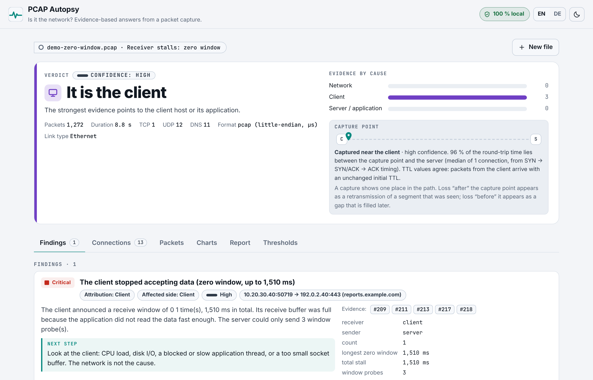
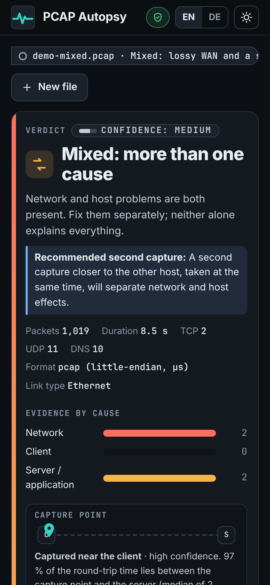
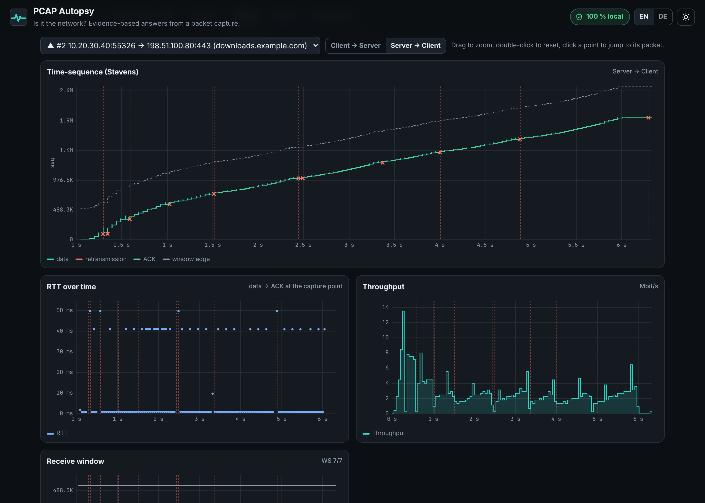

# PCAP Autopsy

**Is it the network?** Drop a packet capture into one HTML file and get an evidence-based,
plain-language answer: network, client, server/application, mixed, or "can't tell from this
capture". Every finding names the packets that prove it, says how sure it is, and what to check next.

It runs offline in your browser. Nothing is uploaded, and a strict Content Security Policy blocks
every network connection.



| Dark | Light | Phone |
|---|---|---|
|  |  |  |



## Use it

1. Download `index.html` (or open the GitHub Pages link).
2. Double-click it. No install, no server. Tested in Chromium (Chrome, Edge); Firefox and Safari
   should work but were not tested.
3. Drop a `.pcap` / `.pcapng` file on the page, or pick one of the 23 synthetic demo captures.

To build it yourself: `node build.js` (Node 18+, no dependencies) writes `index.html` from `src/`.

### Check that nothing leaves your machine

Open DevTools (F12) → **Network**, keep it open and load a capture. The list stays empty apart
from the page itself. The page's CSP contains `connect-src 'none'` and `default-src 'none'`, so
even a bug could not send data. You can also disconnect from the network first; the tool works
the same. Capture data is held in memory only and is gone when you close or reload the tab.
Nothing is written to storage except your language and theme choice.

## What it finds

Per TCP connection and per direction:

| Area | Findings |
|---|---|
| Handshake | SYN without answer, SYN retransmissions, RST on SYN (port closed), slow handshake |
| Loss | retransmissions (fast retransmit vs. timeout), dup ACKs, SACK, tail loss, reordering, spurious retransmissions, where the loss happened relative to the capture point |
| Receiver | zero window (with duration and probes), window full, window too small for the path, missing or ineffective window scaling |
| Server / app | wait from request to first response byte, pauses in a transfer that are not caused by the network |
| Timers | delayed ACK × Nagle stalls at ~40 ms and ~200 ms |
| Queues | bufferbloat (RTT rises with data in flight) |
| MTU | PMTUD blackhole, ICMP Fragmentation Needed / Packet Too Big, MSS mismatch (clamping) |
| Connection end | who sent the RST, aborts, RST probably injected by a middlebox (TTL / hop limit), connections that give up |
| DNS | slow answers, unanswered queries, SERVFAIL, NXDOMAIN |
| TLS | handshake duration, alerts, SNI, version |
| ICMP | destination unreachable and time exceeded, mapped to the connection they belong to |
| UDP / QUIC | detected and listed, marked "not analysable in depth" |
| Capture quality | capture loss, TSO/GRO offload, checksum offload, snap length, missing handshake, keepalives, one-way capture, IP fragments, damaged records |

Results:

- An overall **verdict** with confidence, the evidence score per cause, and what is missing for a
  firmer answer.
- An estimate of **where the capture was taken** (near the client, near the server, in the middle),
  how sure that estimate is, and when a second capture would help.
- Each **finding** has severity (shown by text and shape, not only color), confidence, attribution,
  affected side, measured values, evidence packet numbers, a next step and a Wireshark filter.
- Click a packet number to jump to it in the **packet list**. Every connection has its own filter
  and `tcp.stream` number.
- **Connections** sortable by severity, time or size, each with a timeline.
- **Charts** per connection and direction: time-sequence (Stevens), RTT, throughput and receive
  window, with retransmissions and zero windows marked. Drag to zoom, click a point to open its packet.
- **Export** as a standalone HTML report or Markdown, plus a short ticket text. Exports can replace
  IPs, MACs, hostnames and SNI with consistent placeholders (`[ip-1]`, `[host-2]` …).
- English UI with a German switch, dark and light mode, keyboard navigation and screen-reader labels.

### Input formats

pcap (both byte orders, microsecond and nanosecond timestamps) and pcapng (multiple interfaces,
`if_tsresol`, `if_tsoffset`, EPB/PB/SPB). Link types: Ethernet, 802.1Q VLAN, QinQ (802.1ad),
Linux cooked (SLL and SLL2), raw IP, BSD loopback/null. IPv4 and IPv6 with extension headers and
fragment reassembly. Corrupt, truncated, compressed (gzip/zip) or unsupported files get a clear
message instead of a crash; damaged records in an otherwise good file are skipped and reported.

## How it decides

The core rule: **never claim more than the capture proves.** If the evidence is thin or points
both ways, the verdict says so and names what is missing.

1. **Parse** the file in a Web Worker, 8 MB at a time. Each packet is reduced to about 60 bytes of
   header fields in typed arrays; payloads are not kept.
2. **Track each TCP connection**: unwrap sequence numbers, follow both directions, keep per-direction
   state (highest sequence, holes, SACK blocks, window, RTT samples using Karn's rule).
3. **Classify each event**. Examples:
   - A segment that repeats data already seen is a retransmission. It is *fast* if dup ACKs or
     SACK for the hole came first, *RTO* if a silent gap of at least 0.9 × 200 ms came first,
     *tail loss* if it is the last data, *spurious* if the original was already ACKed.
   - A gap in the sequence space filled later means the segment was lost **before** the capture
     point. A gap that the receiver ACKs without a retransmission means the **capture** lost it
     (the capture tool, not the network), and it is never counted as network loss.
   - Zero window, window probes and keepalives are recognised first, so they never count as loss
     or server delay.
4. **Turn events into findings** using the thresholds below, with confidence lowered when the
   evidence is indirect (no handshake seen, short capture, few samples).
5. **Score the verdict.** Each finding adds severity (critical 3, warning 2, note 0) × confidence
   (high 1, medium 0.6, low 0.3) to its cause. The top cause needs at least 1 point and twice the
   score of the next one; otherwise the verdict is *mixed*. A capture with fewer than 30 packets,
   shorter than 2 s, without TCP data or seen in one direction only gives *inconclusive* instead of
   "no problem found", and any verdict from it gets low confidence.

### Traps it handles

| Trap | What the tool does |
|---|---|
| Capture point | Estimates it from the handshake timing (share of RTT on each side) and TTLs, states how sure it is, and recommends a capture at the other end when it matters |
| Capture loss | ACKed-but-never-seen data is reported as capture loss, not network loss |
| TSO / GRO offload | Segments larger than the MSS are recognised as offload; bad checksums from one host only are reported as checksum offload, not corruption |
| Snap length | Truncated packets are analysed from their headers; payload-based checks are skipped and the snaplen is reported |
| Missing handshake | Window scale is unknown, so window findings are marked "unverified" instead of guessed |
| Short captures | Below 30 packets or 2 seconds, "no problem found" becomes "inconclusive" and any verdict gets low confidence |
| Keepalives, zero-window probes | Recognised before loss detection; their ACKs are not dup ACKs |
| Spurious retransmissions | Reported as a note, not as loss |

### Thresholds

All detectors read their limits from one table in [`src/config.js`](src/config.js). The UI shows
the same table under **Thresholds**.

| Name | Value | Why |
|---|---|---|
| `minPacketsForVerdict` | 30 packets | Below this many packets the capture is too thin for a cause verdict. |
| `minDurationS` | 2 s | Shorter captures rarely contain a full request/response cycle or a retransmission timeout. |
| `synWaitS` | 1 s | A SYN counts as unanswered only if the capture continues this long afterwards (initial RTO is 1 s, RFC 6298). |
| `handshakeRttWarnMs` | 300 ms | Handshake RTT above this is unusual outside satellite or intercontinental paths. |
| `lossWarnPct` | 0.5 % | From about 0.5 % loss, TCP throughput drops noticeably (Mathis et al.: rate ∝ MSS / (RTT·√p)). |
| `lossCritPct` | 2 % | At 2 % loss a single flow typically reaches only a fraction of the path capacity. |
| `lossMinSegments` | 20 segments | Loss rates from fewer data segments are not statistically meaningful; single events are still listed. |
| `dupAckThreshold` | 2 dup ACKs | RFC 5681 uses 3 duplicate ACKs; with SACK (RFC 6675) and Linux, 2 are common. Same rule as Wireshark. |
| `rtoMinMs` | 200 ms | Linux minimum RTO is 200 ms. A retransmission after a silent gap at least this long and without dup ACKs is classed as timeout. |
| `oooMaxMs` | 3 ms | A segment that fills a gap within this time and without dup-ACK or SACK evidence counts as reordering; otherwise as a retransmission. Wireshark uses 3 ms only when it has no RTT sample, else the first RTT, so it calls more gap fills out-of-order (see docs/tshark-comparison.md). |
| `zeroWindowCritMs` | 1000 ms | A receiver that stays at zero window this long blocks the sender for a user-visible time. |
| `windowFullMin` | 3 events | A few window-full events are normal at the start; repeated ones mean the receiver limits the flow. |
| `windowLimitedFraction` | 0.5 share | If at least this share of window-sized rounds ends with the window exhausted, the receive window is the bottleneck. |
| `windowCapMbps` | 100 Mbit/s | A window-limited flow is reported only if window ÷ RTT caps it below this rate; above it, the access link is usually the real limit. |
| `serverDelayWarnMs` | 500 ms | Time from request to first response byte; above this users notice. Must also exceed 5× the network RTT. |
| `serverDelayCritMs` | 2000 ms | Response delays above 2 s usually trigger client or proxy timeouts. |
| `delayVsRttFactor` | 5 × RTT | A wait counts as host-side only if it is much longer than the network round trip. |
| `idleGapMs` | 500 ms | A pause in an ongoing transfer, with all data acknowledged and the window open, comes from the sending application. |
| `delAck40Ms` | 40 ms | Linux delayed-ACK minimum (TCP_DELACK_MIN). |
| `delAck200Ms` | 200 ms | Classic delayed-ACK timer (Windows, BSD, RFC 1122 upper bound 500 ms). |
| `delAckToleranceMs` | 12 ms | Timer jitter allowed around 40 ms / 200 ms (scaled ×2 for 200 ms). |
| `delAckMinCount` | 2 events | One stall could be chance; a repeated stall at the same timer value is a pattern. |
| `bloatFactor` | 3 × min RTT | RTT under load this many times the idle minimum points to a growing queue (bufferbloat). |
| `bloatMinMs` | 50 ms | The increase must also be at least this large in absolute terms. |
| `bloatMinSamples` | 30 samples | Correlation needs enough RTT samples. |
| `bloatMinCorr` | 0.5 ρ | Spearman correlation between bytes in flight and RTT; RTT must rise with load, not randomly. |
| `pmtudMinLen` | 1200 bytes | Only segments at least this large are candidates for a PMTUD blackhole (smaller ones fit even tunnel MTUs). |
| `pmtudMinRetrans` | 2 retransmissions | The same large segment must be repeated at least this often without an ACK. |
| `mssDiffBytes` | 40 bytes | Different MSS values on the two sides suggest MSS clamping or a tunnel on one side. |
| `rstTtlDelta` | 3 hops | A RST whose TTL/hop limit differs this much from the same peer’s other packets was likely sent by a device in the path. |
| `dnsSlowMs` | 300 ms | A cached answer takes a few ms, a recursive one usually < 150 ms. Above this, name resolution adds visible delay. |
| `dnsTimeoutS` | 2 s | A query counts as unanswered if the capture runs this long afterwards without a reply (typical resolver retry interval). |
| `tlsSlowMs` | 1000 ms | A TLS handshake needs 1–2 RTTs plus crypto; above this and above 4× RTT the server or a middlebox is slow. |
| `pointClear` | 0.8 share | Share of the RTT on one side of the capture point needed to call the capture "near client" or "near server". |

## Tests

```
npm test             # 62 core tests: parser, analysis, generator ground truth, traps, formats, fuzzing, exports
npm run test:e2e     # builds index.html and runs 51 browser checks (Playwright, Chromium)
npm run test:tshark  # compares counts with tshark, if installed
```

The **synthetic generator** (`src/gen.js`, `src/scenarios.js`) is a small discrete-event TCP
simulator (slow start, fast retransmit with NewReno, RTO with backoff, SACK, delayed ACK, receiver
read rate, bottleneck queue, MTU blackhole …). It writes captures for every problem type, six
"trap" captures that must **not** produce a network diagnosis, a healthy reference, and seven
format/link-type variants. Because the generator knows which packets it dropped or delayed, the
tests check that the verdict and the evidence packet numbers match what was injected, that
healthy traffic produces no warning, and that corrupt or random input never crashes the parser.

Results from the last run: [docs/e2e-results.txt](docs/e2e-results.txt).

**Comparison with tshark** (TShark 4.2.2): packets and TCP connections match for all 30 captures.
Retransmission, dup-ACK, zero-window and out-of-order counts match for 26 of 30; the four
differences come from how each tool labels a segment lost before the capture point, and from a
keepalive ACK. The generator's ground truth agrees with PCAP Autopsy in all four cases. Details:
[docs/tshark-comparison.md](docs/tshark-comparison.md).

## Size limits

Measured in headless Chromium 153 on Linux (16 GB RAM), opening the file through the normal file
picker. Details and method: [docs/size-limits.md](docs/size-limits.md).

| File | Packets | Connections | Time to verdict | Peak memory |
|---|---:|---:|---:|---:|
| 516 MB | 0.5 million | 1,672 | 4 s | 0.6 GB |
| 2 GB | 2.1 million | 6,471 | 13 s | 0.9 GB |
| 8 GB | 8.3 million | 23,047 | 44 s | 1.7 GB |
| 4 GB, many short connections | 6.4 million | 195,674 | 46 s | 2.9 GB |

Memory grows with packets and connections, not with file size. No test failed, so the real limit
is higher and depends on your machine; if the browser runs out of memory you get a message, not a
crash. Firefox, Safari, Windows and macOS were not measured.

## Known limits

- **One capture point.** A single capture cannot always tell which side of it a problem is on.
  The tool says when this matters and recommends a second capture.
- **Validated on synthetic traffic only.** The detectors are tested against generated captures and
  compared with tshark, but not yet against a library of real-world captures. Real stacks (BBR,
  RACK-TLP, middleboxes that rewrite headers) can produce patterns the generator does not.
- **No decryption.** TLS content and QUIC are opaque. QUIC flows are listed but not analysed.
- **DNS over UDP only.** DNS over TCP, DoT and DoH are not parsed.
- **No HTTP/2 or HTTP/3 request timing**; request/response timing uses TCP payload turns, which is
  wrong for pipelined or multiplexed protocols such as HTTP/2.
- **Sequence wrap** on connections that move more than 4 GB in one direction is handled in code but
  not tested with real data.
- **Link types** other than the seven listed are skipped with a warning. 802.11 radiotap is not
  supported.
- **Thresholds are defaults**, chosen from RFCs and common stack behaviour. Unusual paths
  (satellite, long-fat networks) may need other values in `src/config.js`.

## Project layout

```
src/config.js      thresholds and verdict weights (one place)
src/parser.js      streaming pcap / pcapng / link-layer / IP / TCP / UDP / ICMP decoder
src/store.js       packet store (typed arrays), flows, DNS / TLS / HTTP / QUIC detection
src/analyze.js     per-connection analysis, findings, verdict, capture-point estimate
src/pipeline.js    parser → store → analysis
src/gen.js         synthetic TCP simulator and packet writer
src/scenarios.js   demo and test captures with ground truth
src/i18n.js        English and German texts
src/report.js      HTML / Markdown / ticket export, anonymiser
src/worker.js      Web Worker wrapper
src/charts.js      canvas charts (no library)
src/app.js         user interface
src/template.html  page skeleton; build.js inlines everything and writes the CSP hashes
```

## Sources

- RFC 9293 (TCP, replaces RFC 793), RFC 5681 (congestion control, fast retransmit), RFC 6298
  (retransmission timer), RFC 2018 and RFC 6675 (SACK and SACK-based loss recovery), RFC 7323
  (window scaling, timestamps), RFC 1122 (delayed ACK, keepalive), RFC 896 (Nagle)
- RFC 1191, RFC 8201 (path MTU discovery for IPv4 and IPv6), RFC 4821 (packetization-layer PMTUD),
  RFC 2923 (TCP problems with path MTU discovery)
- RFC 1035 (DNS), RFC 8446 (TLS 1.3), RFC 9000 (QUIC)
- M. Mathis, J. Semke, J. Mahdavi, T. Ott: *The Macroscopic Behavior of the TCP Congestion
  Avoidance Algorithm*, ACM CCR 1997
- J. Gettys, K. Nichols: *Bufferbloat: Dark Buffers in the Internet*, ACM Queue 2011
- W. R. Stevens: *TCP/IP Illustrated, Volume 1* (time-sequence graphs)
- Wireshark documentation: TCP analysis flags, and the pcap / pcapng file format specifications
  (draft-ietf-opsawg-pcap, draft-ietf-opsawg-pcapng)

## License

MIT, see [LICENSE](LICENSE).
